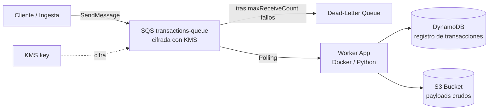

# ⚡ CHALLENGE: “El Guardián del Pipeline - Rescatando la Infraestructura Rota en AWS”

**“La infraestructura no se copia. Se construye con observabilidad, resiliencia y criterio técnico.”**

---

## 🎯 Objetivo

Heredas un pipeline de ingesta financiera asincrónica basado en AWS (emulado localmente sobre LocalStack) que se encuentra en un estado crítico: **la infraestructura no aplica limpiamente, el worker duplica transacciones, los logs se inundan de errores de permisos y las imágenes de contenedor son pesadas e inseguras.**

Tu misión es asumir el rol de Ingeniero/a DevOps: estabilizar el entorno, refactorizar la infraestructura como código sin causar pérdida de datos, blindar la seguridad bajo el principio de menor privilegio y optimizar el procesamiento.

---

## 🗺️ Arquitectura del Sistema



---

## 🛡️ Tu Misión

El challenge está diseñado para que avances paso a paso según tu nivel técnico actual. No es obligatorio completar todos los niveles para entregar:

Levantar el entorno y diagnosticar el estado actual:

1. Detectar por qué Terraform falla en su primer apply contra LocalStack.

2. Analizar los logs del worker para entender por qué las transacciones rebotan continuamente.

3. Refactorizar y asegurar la infraestructura (terraform/):

    3.1. Actualizar recursos deprecados de S3 a la versión del AWS Provider v5.

    3.2. Modularizar main.tf en submódulos limpios (modules/messaging, modules/storage, modules/iam).

    > Regla estricta: La refactorización no debe destruir ni recrear recursos existentes en el .tfstate.

    3.3. Reemplazar las políticas IAM con wildcards (*/*) por el principio de menor privilegio.

4. Hardening del Worker (src/worker/):

    4.1. Optimizar el Dockerfile (reducir drásticamente su tamaño y forzar ejecución sin privilegios de root).

    4.2. Corregir el ciclo de vida de consumo en SQS para evitar la reentrega infinita de transacciones.

    <!-- Hay secretos y detalles ocultos que también se evaluarán. -->

    “Tu misión no es solo hacer que el script pase en verde, es diseñar para la falla.
    LocalStack es tu simulador, pero las transacciones representan dinero real.
    Recuerda: los mejores ingenieros encuentran los errores en las sutilezas que otros pasan por alto.”

## 🎁 El Espíritu del Guardián

Si entendiste el valor de la resiliencia en la nube y lograste que el pipeline procese 10 transacciones consecutivas con 0 mensajes caídos en la DLQ, incluye al inicio de tu `README.md`:
> *“En la nube no confiamos en la suerte: construimos para la falla y gobernamos con código.”*

## 🐳 Bonus opcionales

- Graceful Shutdown POSIX: Capturar señales SIGTERM/SIGINT en Python para permitir que las transacciones en vuelo finalicen antes de que el contenedor muera.

- Batching en SQS: Migrar el consumo de mensajes unitarios (MaxNumberOfMessages=1) a lotes de hasta 10 mensajes sin generar condiciones de carrera.

- Tests automáticos del worker: un `pytest` con [`moto`](https://github.com/getmoto/moto) que simule SQS, S3 y DynamoDB y cubra al menos el procesamiento correcto, la idempotencia ante reentregas y que un fallo deje el mensaje en la cola.

- Mensajes venenosos: un mensaje que nunca se podrá procesar (JSON inválido, sin `transaction_id`, etc.) no debe bloquear la cola, tumbar el worker ni dejar basura en S3: debe terminar aislado en la DLQ mientras las transacciones válidas siguen fluyendo. Para probarlo usa `./scripts-challenge/bonus/poison-messages.sh` (`list` muestra los casos, `check` los inyecta y audita el resultado). Este bonus no suma al puntaje automático; se evalúa en la defensa.

- Diagrama o ADR: un documento corto en tu entrega (`docs/ARCHITECTURE.md` o `docs/adr/0001-*.md`) con un diagrama del flujo (por ejemplo en Mermaid) y al menos una decisión de diseño, con el contexto, las alternativas que descartaste y las consecuencias. Por ejemplo: cómo elegiste el `VisibilityTimeout`, por qué `moved {}` en lugar de `state mv`, o cómo garantizas la idempotencia.

## 📜 Reglas

Lee atentamente las reglas en [RULES.md](RULES.md) antes de comenzar.

---

## 🧰 Requisitos y Herramientas

- **Git**
- **Docker** (>= 24.0) y **Docker Compose v2** (`docker compose`, no `docker-compose`)
- **Terraform** (>= 1.5.0)
- **AWS CLI** (>= 2.x) o utilidades `awslocal`
- **jq** y **curl**
- Scripts brindados en `scripts-challenge/`:
  - `scripts-challenge/0-check-prerequisites.sh`
  - `scripts-challenge/seed-data.sh`
  - `scripts-challenge/verify-pipeline.sh` (auditoría; termina con código ≠ 0 si algo falla; `--with-shutdown` prueba además el apagado ordenado)
  - `scripts-challenge/check-challenge-points.sh` (puntaje estimado sobre 100)
  - `scripts-challenge/reset-env.sh` (limpia el entorno y permite repetir las pruebas desde cero)
  - `verify.sh` (verificación rápida en la raíz: 10 transacciones sin mensajes en la DLQ)
  - `scripts-challenge/CHECKSUMS` (hashes sha256 de los scripts brindados; no se modifican, ver RULES.md, punto 4)

---

## 🗂️ Estructura del repositorio

Esto es lo que recibes:

```bash
.
├── ENUNCIADO.md · RULES.md · verify.sh
├── docker-compose.yml            # LocalStack + worker
├── terraform/                    # infraestructura como código
├── src/worker/                   # worker en Python y su Dockerfile
└── scripts-challenge/            # scripts de verificación y utilidades - Prohibido modificar
```

---

## 🚀 Pasos para empezar

### 1. Verificar prerrequisitos

```bash
chmod +x scripts-challenge/*.sh
./scripts-challenge/0-check-prerequisites.sh
```

Si todo está en orden obtendrás:   

```bash
🔍 VERIFICANDO REQUISITOS DEL SISTEMA...
========================================
1. Verificando Docker... ✅ Docker 29.6.2 activo (>= 24.0)
2. Verificando Docker Compose v2... ✅ Docker Compose v2 (5.3.1) instalado correctamente
3. Verificando Terraform... ✅ Terraform v1.16.5 instalado (>= 1.5.0)
4. Verificando utilidades auxiliares (jq, curl, AWS CLI)... ✅ Herramientas CLI disponibles (jq, curl, AWS CLI)
5. Verificando versión de AWS CLI... ✅ AWS CLI 2.37.12 (>= 2.x)
6. Verificando puerto 4566... ✅ Puerto 4566 libre
7. Verificando espacio en disco... ✅ Espacio suficiente
8. Verificando variables de entorno de AWS... ✅ Sin perfil de AWS configurado

🎉 ¡TODOS LOS REQUISITOS CUMPLIDOS!
Puedes proceder a levantar LocalStack con: docker compose up -d localstack
```

### 1.1 Configurar credenciales de AWS (dummy)

No necesitas `aws login`, `aws sso login` ni una cuenta real de AWS: todo corre contra LocalStack. Solo hacen falta credenciales **dummy**:

```bash
export AWS_ACCESS_KEY_ID=test
export AWS_SECRET_ACCESS_KEY=test
export AWS_DEFAULT_REGION=us-east-1
export AWS_ENDPOINT_URL=http://localhost:4566   # hace que la AWS CLI apunte a LocalStack
```

O, de forma persistente, con un perfil dedicado:

```bash
aws configure --profile localstack   # key: test / secret: test / region: us-east-1 / output: json
export AWS_PROFILE=localstack
```

> ⚠️ Si tienes credenciales reales o un `AWS_PROFILE` exportado, pueden pisar las dummy. Haz `unset AWS_PROFILE` o exporta las variables anteriores. Sin `AWS_ENDPOINT_URL` / `--endpoint-url`, la AWS CLI irá contra AWS real.

### 1.2 Problemas frecuentes

| Síntoma | Causa | Solución |
| --- | --- | --- |
| `AWS.SimpleQueueService.NonExistentQueue` al correr `seed-data.sh` | La cola la crea Terraform; aún no se aplicó, falló o LocalStack se reinició sin persistencia | Ejecuta `./scripts-challenge/reset-env.sh --up` (limpia, levanta LocalStack y aplica Terraform) y vuelve a sembrar |
| No puedes borrar `.localstack/` | Lo crea root el contenedor | Usa `reset-env.sh`, que lo borra desde un contenedor |
| `Error acquiring the state lock` | Otro proceso de Terraform (p. ej. un `plan` en segundo plano de tu editor) tiene el estado bloqueado | Espera unos segundos y reintenta. Si queda colgado, verifica con `ps` que no haya otro Terraform y usa `terraform force-unlock <ID>`. Evita `-lock=false` |
| `WARN ... attribute 'version' is obsolete` | Aviso de Docker Compose v2 | Es inofensivo |

### 1.3 Reproducibilidad

Para que tus pruebas sean comparables entre corridas:

- **Empieza desde cero cuando dudes:** `./scripts-challenge/reset-env.sh --full` destruye contenedores, datos de LocalStack y el state local de Terraform, y vuelve a levantar todo. Sin opciones solo limpia; con `--up` además levanta LocalStack y aplica Terraform; con `--full` también construye y arranca el worker.
- **LocalStack no persiste datos al recrear el contenedor:** tras un `docker compose down` hay que volver a ejecutar `terraform apply`. El síntoma típico es `NonExistentQueue`.
- **`.localstack/` pertenece a root** (lo crea el contenedor). No lo borres con tu usuario; usa `reset-env.sh`.
- **El state de Terraform es local y no se versiona.** Si lo borras, Terraform querrá recrear todo; por eso la preservación de estado se evalúa con `terraform plan`, que debe quedar sin cambios.
- **Versiones:** el provider AWS está fijado por `terraform/.terraform.lock.hcl`; no lo elimines. LocalStack usa la versión indicada en `docker-compose.yml`.
- **Los conteos son relativos a cada corrida:** `verify-pipeline.sh` inyecta IDs únicos y espera activamente (hasta `WAIT_TIMEOUT`, 150 s por defecto), por lo que no depende de datos previos ni de esperas fijas.
- **Evidencia:** la salida de `verify-pipeline.sh --with-shutdown` tras un `reset-env.sh --full` es la que debes adjuntar.

### 2. Iniciar LocalStack

```bash
docker compose up -d localstack
```

### 3. Intentar inicializar la infraestructura

```bash
cd terraform
terraform init
terraform apply
```

(Aquí te toparás con los primeros errores y advertencias que deberás diagnosticar e ir resolviendo).

```
Plan: 7 to add, 0 to change, 0 to destroy.
╷
│ Warning: Argument is deprecated
│
│   with aws_s3_bucket.payload_bucket,
│   on main.tf line 75, in resource "aws_s3_bucket" "payload_bucket":
│   75: resource "aws_s3_bucket" "payload_bucket" {
│
│ server_side_encryption_configuration is deprecated. Use the
│ aws_s3_bucket_server_side_encryption_configuration resource instead.
│
│ (and 3 more similar warnings elsewhere)
╵

Do you want to perform these actions?
  Terraform will perform the actions described above.
  Only 'yes' will be accepted to approve.

  Enter a value: yes
```

Luego esperaremos hasta ver 4 veces seguidas "`aws_s3_bucket.payload_bucket: Still creating...`" y cortaremos el apply

```
aws_kms_key.pipeline_key: Creating...
aws_sqs_queue.transactions_dlq: Creating...
aws_iam_role.worker_role: Creating...
aws_dynamodb_table.transactions: Creating...
aws_s3_bucket.payload_bucket: Creating...
aws_dynamodb_table.transactions: Creation complete after 0s [id=transactions]
aws_kms_key.pipeline_key: Creation complete after 4s [id=eb968ac9-87c4-4af6-bc36-472ba63fd25d]
aws_sqs_queue.transactions_queue: Creating...
aws_sqs_queue.transactions_dlq: Still creating... [00m10s elapsed]
aws_s3_bucket.payload_bucket: Still creating... [00m10s elapsed]
aws_sqs_queue.transactions_queue: Still creating... [00m10s elapsed]
aws_sqs_queue.transactions_dlq: Still creating... [00m20s elapsed]
aws_s3_bucket.payload_bucket: Still creating... [00m20s elapsed]
aws_sqs_queue.transactions_queue: Still creating... [00m20s elapsed]
aws_sqs_queue.transactions_dlq: Creation complete after 25s [id=http://sqs.us-east-1.localhost.localstack.cloud:4566/000000000000/transactions-dlq]
aws_sqs_queue.transactions_queue: Creation complete after 25s [id=http://sqs.us-east-1.localhost.localstack.cloud:4566/000000000000/transactions-queue]
aws_s3_bucket.payload_bucket: Still creating... [00m30s elapsed]
aws_s3_bucket.payload_bucket: Still creating... [00m40s elapsed]
aws_s3_bucket.payload_bucket: Still creating... [00m50s elapsed]
aws_s3_bucket.payload_bucket: Still creating... [01m00s elapsed]
```

Al cortar el apply deberíamos ver algo así:

```
^C
Interrupt received.
Please wait for Terraform to exit or data loss may occur.
Gracefully shutting down...

Stopping operation...
╷
│ Warning: Argument is deprecated
│
│   with aws_s3_bucket.payload_bucket,
│   on main.tf line 75, in resource "aws_s3_bucket" "payload_bucket":
│   75: resource "aws_s3_bucket" "payload_bucket" {
│
│ server_side_encryption_configuration is deprecated. Use the aws_s3_bucket_server_side_encryption_configuration resource instead.
│
│ (and one more similar warning elsewhere)
╵
╷
│ Error: execution halted
│
│
╵
╷
│ Error: execution halted
│
│
╵
╷
│ Error: creating S3 Bucket (corporate-transactions-raw-payloads): context canceled
│
│   with aws_s3_bucket.payload_bucket,
│   on main.tf line 75, in resource "aws_s3_bucket" "payload_bucket":
│   75: resource "aws_s3_bucket" "payload_bucket" {
│
╵
╷
│ Error: creating IAM Role (pipeline-worker-role): operation error IAM: CreateRole, https response error StatusCode: 501, RequestID: fb31ae3b-e238-47b6-80c3-1f6fb062e00d, api error InternalFailure: Service 'iam' is not enabled. Please check your 'SERVICES' configuration variable.
│
│   with aws_iam_role.worker_role,
│   on main.tf line 103, in resource "aws_iam_role" "worker_role":
│  103: resource "aws_iam_role" "worker_role" {
│
╵
```

Acá es dónde deberemos resolver el problema para avanzar.

### 4. Probar el pipeline y verificar fallas

Una vez que el worker esté arriba y la infraestructura aplicada:

```bash
# Inyectar 5 transacciones de prueba
./scripts-challenge/seed-data.sh 5

# Auditar el estado del procesamiento
./scripts-challenge/verify-pipeline.sh
```

Verás que inicialmente los mensajes fallan, se duplican o caen en la cola de mensajes muertos (DLQ).

Si todo está bien, deberías observar lo siguiente:

```bash
./scripts-challenge/verify-pipeline.sh --with-shutdown
=================================================================
   🔍 AUDITORÍA DE PIPELINE: EL GUARDIÁN DE LA INFRAESTRUCTURA
=================================================================

[1/6] Verificando salud del entorno local...
  ✔ LocalStack respondiendo correctamente.
  ✔ Scripts de auditoría íntegros (coinciden con scripts-challenge/CHECKSUMS).

[2/6] Auditando infraestructura como código (Terraform)...
  ✔ Terraform State intacto: 0 cambios pendientes.

[3/6] Verificando seguridad y configuración desplegada...
  ✔ Menor privilegio: ninguna política IAM desplegada usa wildcards.
  ✔ Hardening de contenedor: el worker corre con usuario no privilegiado (1000:1000).
  ✔ VisibilityTimeout = <N>s (>= 20s): cubre el tiempo de procesamiento.
  ✔ Redrive policy apunta a la DLQ real (arn:aws:sqs:us-east-1:000000000000:transactions-dlq).
  ✔ S3: acceso público bloqueado en sus cuatro dimensiones.
  ✔ S3: cifrado del lado del servidor configurado.

[4/6] Inyectando 10 transacciones únicas y esperando su procesamiento...
  → 10/10 inyectadas (corrida 1700000000-1234). Máximo de espera: 150s.
  ✔ Las 10 transacciones quedaron en DynamoDB y S3 en 24s.

[5/6] Auditando colas y ausencia de duplicados...
  ✔ Cola principal vacía: el worker borra cada mensaje tras procesarlo.
  ✔ DLQ limpia: ningún mensaje cayó a la Dead-Letter Queue.
  ✔ Sin duplicados: cada transacción se procesó una sola vez.

[6/6] Apagado ordenado (SIGTERM)...
  ✔ Apagado ordenado: la transacción en vuelo se completó y el worker salió con código 0.

=================================================================
                     VEREDICTO DE AUDITORÍA
=================================================================

🎉 ¡FELICITACIONES! El pipeline es funcional, seguro y consistente.
```

# 🧩 Consideraciones y Ojos Curiosos

- Cuidado con el DNS local: LocalStack resuelve S3 de manera distinta a AWS real; presta atención a cómo el SDK y el provider configuran las URLs de acceso a buckets.

- La trampa del State: Si ejecutas un terraform apply que destruye y recrea la tabla de DynamoDB o la cola SQS, simularías una pérdida de datos catastrófica en un entorno productivo real.

- Existen detalles de seguridad no mencionados en el enunciado principal: (bloqueo de acceso público en S3, retención de logs, etc.). Cualquier hardening extra sumará valor a tu entrega.

**“Una arquitectura no se define por cómo funciona cuando todo va bien, sino por cómo resiste cuando todo falla.”**

# 📦 Estructura de Entrega Esperada

Sube tu solución a un repositorio privado de GitHub (o compártelo según las indicaciones del equipo de selección) con la siguiente estructura:

```bash
mi-solucion-pipeline/
├── terraform/
│   ├── main.tf             <-- Configuración principal o llamadas a módulos
│   ├── moved.tf            <-- Bloques de preservación de estado
│   ├── outputs.tf          <-- Salidas (si las usas)
│   └── modules/
│       ├── messaging/
│       ├── storage/
│       └── iam/
├── src/
│   └── worker/
│       ├── Dockerfile      <-- Imagen optimizada (non-root, multi-stage)
│       ├── main.py         <-- Worker con graceful shutdown y manejo de errores
│       └── requirements.txt
├── docker-compose.yml      <-- Orquestación local corregida con healthchecks
├── Makefile                <-- Comando orquestador (`make up`), o un script documentado
└── README.md               <-- Tu documentación, respuestas técnicas y bitácora
```

Los scripts de `scripts-challenge/` los pones tal cual, sin modificar (ver RULES.md, punto 4). Los tests automáticos del worker son un bonus.

Contenido obligatorio del README.md:

1. Bitácora de resolución: Qué errores encontraste, cómo los diagnosticaste y qué decisión tomaste para solucionarlos.

2. Defensa de las 7 preguntas técnicas:

    2.1. ¿Por qué los mensajes caían a la DLQ y bajo qué criterio dimensionaste el timeout de visibilidad?

    2.2. ¿Cómo garantizaste que la refactorización a módulos no destruyera recursos en el .tfstate?

    2.3. ¿Por qué una política de IAM permisiva sigue fallando si la KMS Key Policy no está configurada correctamente?

    2.4. ¿Cómo maneja tu worker el apagado del contenedor (SIGTERM) para evitar inconsistencias entre S3 y DynamoDB?

    2.5. ¿Qué pasa con el mensaje si S3 funciona y DynamoDB falla? ¿Se pierde, se duplica o se reintenta?

    2.6. ¿Qué cambiarías de este diseño para llevarlo a AWS real? Menciona al menos 3 puntos (por ejemplo, credenciales, state remoto o alarmas).

    2.7. ¿Qué parte del challenge no pudiste resolver o resolverías distinto con más tiempo?

3. Uso de IA (obligatorio, RULES.md, punto 7): Detallar con honestidad si utilizaste IA, para qué tareas específicas te apoyaste en ella, cómo validaste sus sugerencias y en qué tareas de un trabajo real la aprovecharías sin estas restricciones.

4. Evidencias: Salida de `./scripts-challenge/verify-pipeline.sh --with-shutdown` confirmando la ingesta limpia.

# 🧠 Objetivo real el challenge: análisis crítico y criterio

No buscamos una solución de manual copiada de internet o perfección técnica. Buscamos:

- **Curiosidad:** ¿Investigaste lo que no entendías?

- **Creatividad:** ¿Usaste enfoques originales?

- **Criterio de ingeniería:** ¿Entiendes el impacto de cada parámetro que modificas?

- **Higiene de seguridad:** ¿Aplicas menor privilegio o recurres a permisos globales para que "simplemente ande"?

- **Tratamiento del estado:** ¿Cuidas la persistencia de los datos existentes?

- **Claridad de comunicación:** ¿Tus explicaciones técnicas demuestran dominio del problema?

- **Atención al detalle:** ¿Notaste lo que otros ignoran?

- **Ética:** ¿Resolviste el reto con tus propias manos y mente? ¿Dejaste detallado el uso de la IA que realizaste?

> “Los mejores ingenieros no son los que nunca se equivocan, sino los que saben leer los logs, entender el sistema y reparar los cimientos sin derribar el edificio.”

# 📚 Documentación de Referencia
- [LocalStack Documentation](https://docs.localstack.cloud/)
- [Terraform AWS Provider Documentation](https://registry.terraform.io/providers/hashicorp/aws/latest/docs)
- [Terraform Refactoring with moved Blocks](https://developer.hashicorp.com/terraform/language/modules/develop/refactoring)
- [Amazon SQS Message Visibility Timeout](https://docs.aws.amazon.com/AWSSimpleQueueService/latest/SQSDeveloperGuide/sqs-visibility-timeout.html)